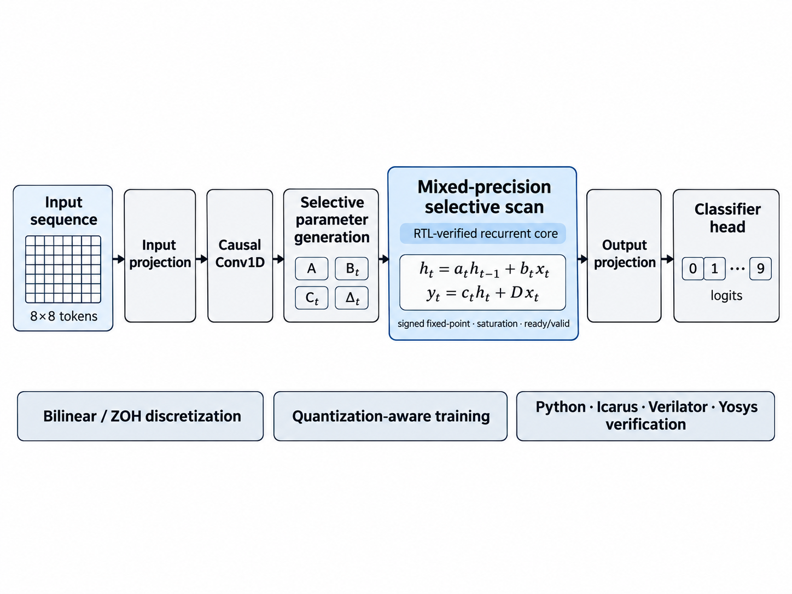

# FPGA_Mamba

Fixed-point selective state-space inference with trained-model RTL verification.

The project implements a Mamba-derived sequence classifier in PyTorch and a synthesizable, mixed-state-precision recurrent scan in SystemVerilog. The input projection, convolution, selective parameter generation, gate, output projection and classifier remain on the host. The scan consumes coefficients exported from the trained network. FPGA board execution is not included.



[Technical pipeline diagram (editable SVG)](docs/system_pipeline.svg) | [RTL datapath](docs/architecture.svg)

## Results

| Measurement | Result |
| :--- | ---: |
| Bilinear model test accuracy | 96.11% on 360 held-out digit images |
| ZOH model test accuracy | 95.56% on the same test set |
| RTL-fed classification | 49/50 correct (98%) |
| RTL vs integer-reference logits | Maximum absolute difference: 0 |
| RTL recurrent output transfers | 400, across 712 test cycles |
| Icarus / Verilator | Both passed the trained-model scan regression |
| Scalar-scan regression | 7,200 comparisons per simulator, four lanes |
| Generic Yosys mapped logic | 159,012 cells for `precision_scan` |

The 50-image inference experiment uses RTL-computed recurrent outputs and a PyTorch classifier head. The 98% result is not a full-RTL or FPGA-board accuracy measurement. The synthesis cell count is technology-independent; no LUT, DSP, power or timing result is claimed.

## Architecture

The dataset is `sklearn.datasets.load_digits`. Each 8 × 8 image is processed as eight tokens with eight values per token. The trainable network uses input and gate projections, causal depthwise convolution, selective state-space parameters, output gating, an output projection, residual addition and a ten-class head.

The recurrent scan implements eight channels and four states per channel. For channel `d`, state index `n` and token `t`:

\[
h_{t,d,n}=\bar a_{t,d,n}h_{t-1,d,n}+e_{t,d,n},
\qquad
 y_{t,d}=\sum_n C_{t,n}h_{t,d,n}+D_d u_{t,d}.
\]

`rtl/precision_scan.sv` receives quantized `alpha`, `excitation`, `c`, `skip` and `u` values from the model. It does not calculate projections or discretization coefficients internally.

### Discretization and quantization

The trained model supports zero-order hold (ZOH) and bilinear (Tustin) discretization of diagonal continuous-time poles. For the bilinear variant:

\[
\bar a=\frac{1+\Delta A/2}{1-\Delta A/2},
\qquad
\bar b=\frac{\Delta}{1-\Delta A/2}.
\]

The external RTL interface uses signed 16-bit Q6.10. Each state uses six integer/sign bits and a compile-time selected number of fractional bits, `p[d,n]`. Arithmetic includes nearest-even rescaling, signed saturation and a ready/valid streaming interface. The bit allocation in `results/precision64.json` is calibrated offline and emitted to `rtl/precision_config.svh`; it does not change at runtime.

The retained `rtl/selective_scan.sv` is a separate Q4.12, scalar-per-lane baseline with its own verification suite.

## Reproduce

Requirements: Python 3.10 or later, PyTorch, NumPy, scikit-learn, Icarus Verilog, Verilator, Yosys and GNU Make. The checked-in checkpoints are small and avoid retraining for the verification path.

```bash
python3 -m venv .venv
source .venv/bin/activate
python -m pip install -r requirements-research.txt

make -f Makefile.research research-evaluate
make -f Makefile.research release-check
make reference lint directed verilator iverilog
```

`release-check` runs numerical tests, Verilator lint, trained-model vector export, scan simulation in Icarus and Verilator, classifier injection, comparison of the two simulator traces and Yosys synthesis. Generated traces and reports are placed in `build/`.

To inspect the independent RTL-fed classification reports:

```bash
cat build/rtl_classifier_iverilog.json
cat build/rtl_classifier_verilator.json
```

Retraining from the fixed split and seed:

```bash
python -m model.train --scheme bilinear --epochs 32 --seed 19 --output build/bilinear
python -m model.train --scheme zoh --epochs 32 --seed 19 --output build/zoh
```

Retraining may produce different checkpoints if library versions or numerical kernels differ. The included checkpoints are used for the recorded results.

## State precision experiment

A validation-set calibration procedure assigns fractional precision to each recurrent state under a fixed bit budget. The supplied 32-state configuration uses 64 fractional bits across all states. Including six integer/sign bits per state, its nominal state storage is 256 bits versus 512 bits for a uniform 16-bit representation.

At an equal precision budget, the recorded held-out logit MSE relative to the full-Q6.10 scan is 0.3110 for calibrated allocation and 0.3893 for uniform two-fractional-bit state storage. The calibrated configuration does not improve held-out accuracy relative to the uniform two-bit comparison. Register-bit totals are theoretical; a physical FPGA resource reduction has not been measured.

This is an offline precision-allocation experiment, not a runtime precision scheduler or a demonstrated research novelty claim.

## Source layout

```text
rtl/                     Synthesizable selective-scan modules
model/                   Model training, evaluation, integer reference, export
python/                  Scalar fixed-point oracle and vector generator
tb/                      SystemVerilog testbenches
tests/                   Python numerical and integration tests
weights/                 Trained digit-classifier checkpoints
results/                 Recorded calibration and evaluation data
docs/                    Architecture figures, verification and experiments
tools/                   Release report validation
Makefile                  Scalar-scan build and verification
Makefile.research         Trained-model scan and release verification
```

Additional information: [Verification](docs/verification.md), [RTL-fed inference](docs/RTL_CLASSIFIER.md), [Precision experiment](docs/RESEARCH.md), [Measured evidence](docs/RELEASE_EVIDENCE.md).

## Limitations

The model is Mamba-derived, not a compatible implementation of official Mamba-1 or Mamba-2 weights. The supplied recurrent scan is synthesizable, but no board-specific FPGA top, weight-loading subsystem, complete RTL network, placement, timing closure or power measurement is provided. An FPGA accelerator requires these components and full-network quantization verification before a deployment or performance claim.

## References

- A. Gu and T. Dao, [Mamba: Linear-Time Sequence Modeling with Selective State Spaces](https://arxiv.org/abs/2312.00752), 2023.
- [LightMamba: Efficient Mamba Acceleration on FPGA with Quantization and Hardware Co-design](https://arxiv.org/abs/2502.15260), 2025.
- [ViM-Q: Scalable Algorithm-Hardware Co-Design for Vision Mamba Model Inference on FPGA](https://arxiv.org/abs/2605.01935), 2026.
