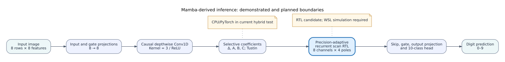

# FPGA_Mamba

A reproducible Mamba-derived sequence classifier and an experimental fixed-point selective-state-space datapath. The repository separates training, numerical verification, RTL simulation, and FPGA implementation. The available hardware implements the recurrent scan; the full neural network is **not** deployed on an FPGA.




### RTL-fed classification regression

The optional integration test extracts **consumed outputs from the RTL scan**
and injects them into the trained PyTorch classifier head, with per-channel
numerical equality checks and per-sample prediction reports. This is an
end-to-end classification **simulation using RTL-produced scan outputs**, not
a wholly RTL implementation or physical FPGA deployment. See
[RTL classifier integration](docs/RTL_CLASSIFIER.md).

```bash
python3 -m unittest tests.test_rtl_classifier -v
make -f Makefile.research scan-rtl-classify-iverilog
make -f Makefile.research scan-rtl-classify-verilator
make -f Makefile.research release-verify
```

## Verified RTL-assisted prediction result

The **recurrent scan** produced 400 consumed outputs from 50 held-out handwritten-digit images under a 712-cycle ready/valid stimulus. The Icarus Verilog run reported **49/50 correct predictions (98%)** after the RTL outputs were injected into the trained PyTorch classifier. Its final logits agreed exactly with the independent integer scan reference; 1 prediction differed from the floating-point model. The Verilator scan passed the same 712 cycle vector regression. **The latest supplied log does not yet show a Verilator classifier-injection report.** The release gate below runs both complete paths and asserts that their traces match.

```bash
make -f Makefile.research release-check
```

This gate runs Python tests, trained-model scan simulation and RTL-assisted classification in **both** simulators, numerical/trace comparison, and generic logic synthesis. It **does not** imply that the projections, convolution, gating or classifier are implemented in FPGA fabric. `scan-synth` reports generic mapped cells, not FPGA LUTs, DSPs, timing or power.

See [Release evidence and limitations](docs/RELEASE_EVIDENCE.md).

## Scope

The model processes the 8 × 8 handwritten-digit images supplied by `sklearn.datasets.load_digits` as eight sequential 8-feature tokens. It contains input and gate projections, a causal depthwise convolution, learned selective coefficients, a diagonal recurrent state-space layer, output gating/projection, and a 10-class classification head. This is a compact Mamba-derived architecture, **not** a drop-in implementation of official Mamba-1 or Mamba-2 checkpoints.

The hardware consists of two separate cores:

- `rtl/selective_scan.sv`: the original signed Q4.12 scalar-per-lane recurrence with backpressure. Its testbench was rewritten to avoid simulator-specific `$fscanf` signal-update behavior.
- `rtl/precision_scan.sv`: an experimental Q6.10 multi-state scan with 8 channels × 4 poles, individually parameterized state fractional precision, and clocked ready/valid transactions. Its model coefficients are supplied externally.

The second core is the research extension. It does **not** implement convolution, parameter generation, gating, the classifier head, DDR, DMA, or a device-specific FPGA top.

## Mathematical model

For token `t`, channel `d`, and pole `n`, the real-valued diagonal state-space recurrence is

\[
 h_{t,d,n}=\bar a_{t,d,n}h_{t-1,d,n}+e_{t,d,n},\qquad
 y_{t,d}=\sum_{n=0}^{3}c_{t,n}h_{t,d,n}+D_d u_{t,d}.
\]

The continuous-time diagonal poles are negative. The trained model quantizes each input-dependent time step to a four-entry codebook `Δ ∈ {0.125, 0.25, 0.5, 1.0}`. The bilinear (Tustin) coefficients are

\[
 \bar a=\frac{1+\Delta A/2}{1-\Delta A/2},\qquad
 \bar b=\frac{\Delta}{1-\Delta A/2}.
\]

The excitation sent to the scan is the quantized value of `\bar b B_t u_t`. A separate zero-order-hold (ZOH) model is provided as an ablation; ZOH and bilinear discretization are established techniques, not claimed inventions.

### Numerical contract

The external scan buses use signed 16-bit Q6.10. Multiplication and state accumulation use explicitly signed intermediate values, nearest-even integer rescaling, and signed saturation. State `(d,n)` stores `6 + p[d,n]` bits in signed Q6.`p[d,n]` format, where `p` is a compile-time constant in `[0, 10]`.

The file `rtl/precision_config.svh` is generated from `results/precision64.json`. A 4-bit constant per state configures the RTL `generate` blocks. Each valid token updates all 32 states. State updates occur only on `in_valid && in_ready`, and the output is retained while `out_valid && !out_ready`. `sequence_start` clears the previous sequence state for the accepted token. `rst_n` asynchronously resets state and output valid/data.

### Research hypothesis: state precision allocation

Uniform precision ignores differing state sensitivities. This repository evaluates a *calibrated* allocation that combines single-pole logit perturbations with a lifetime term derived from the Tustin pole magnitude. Its dynamic-programming allocator minimizes an **additive calibration proxy** under a fixed total state-bit budget. It does not provide a certified end-to-end network error bound.

For one contractive state with `|\bar a_t| ≤ ρ < 1` and rounding noise `|\eta_t| ≤ ε`, the propagated error obeys

\[
 |E_t|\le ρ^t|E_0|+\epsilon\frac{1-ρ^t}{1-ρ}.
\]

This motivates higher precision for longer-lived states. Output sensitivity and numerical calibration matter as well. The current allocation is an experimental co-design idea; **research novelty has not been established against all relevant prior work**.

## Reproduce the software results

Use Linux or WSL, Python 3.10+, and a clean virtual environment. Existing WSL dependencies can be reused.

```bash
cd ~/projects/FPGA_Mamba
# An existing environment with torch/sklearn/pytest may be used.
source ~/projects/Embedded_SNN/.venv/bin/activate
python -m pip install -r requirements-research.txt

make -f Makefile.research research-check
make -f Makefile.research research-evaluate
make -f Makefile.research research-hybrid
make -f Makefile.research research-precision
```

To train again, rather than using the included small checkpoints:

```bash
python -m model.train --scheme bilinear --epochs 32 --seed 19 --output build/bilinear
python -m model.train --scheme zoh --epochs 32 --seed 19 --output build/zoh
```

The fixed split contains 1,149 training, 288 validation and 360 test images, with no overlap. Dataset samples are real handwritten digits, although this is a small benchmark and not a representative large-scale Mamba workload.

## RTL regression on trained-model inputs

The recurrent scan receives real tokens produced by a trained model. The rest of the network runs on the host: this is **hybrid co-simulation**, not complete FPGA inference.

```bash
make -f Makefile.research research-vectors
make -f Makefile.research scan-lint
make -f Makefile.research scan-iverilog
make -f Makefile.research scan-verilator
make -f Makefile.research scan-synth
```

`research-vectors` builds 50 held-out image sequences (400 scan tokens), with deterministic stalls, bubbles, resets, and sequence boundaries. It writes `build/model_scan_vectors.txt` and a summary report. Both simulators compare the entire scan output and handshake against a separately coded integer reference; **the trained-model scan passed 712 cycles in both Icarus and Verilator in the reported WSL run**.

The older Q4.12 core has its own reference and test targets:

```bash
make reference
make lint
make directed
make verilator
make iverilog
make synth
```

The legacy randomized Verilator regression previously failed at cycle 4. The corrected testbench subsequently passed 7,200 cycle comparisons in Verilator and 7,200 in Icarus across three seeds and four lanes.

## Measured software results

These are deterministic CPU/PyTorch results from the included checkpoints. They are **not** FPGA throughput, area, power, or board measurements.

| Experiment | Result |
|---|---:|
| Bilinear + QAT test accuracy, 360 digits | 96.11% |
| ZOH + QAT test accuracy, 360 digits | 95.56% |
| Full-precision integer-scan hybrid vs PyTorch logits | Exact agreement (360 digits) |
| Mixed-precision integer-scan hybrid test accuracy | 96.11% (360 digits) |
| Uniform state precision at 2 fractional bits: logit MSE vs Q6.10 | 0.3893 |
| Calibrated precision at equal bit budget: logit MSE vs Q6.10 | 0.3110 |
| State storage for uniform Q6.10, 32 poles | 512 bits |
| State storage for mixed precision, 32 poles | 256 bits |

The state-storage numbers are theoretical register-bit counts only, not mapped FPGA FF counts or total area. The 20.1% lower logit MSE is a result on this particular dataset/checkpoint; **the calibrated model does not improve held-out classification accuracy** relative to the uniform 2-bit state experiment.

The software allocator was fitted on validation data. Test labels were not used to select its bit map. Full experimental records are in `results/`.

## Repository layout

```text
rtl/                      Fixed-point recurrence RTL
  selective_scan.sv       Original Q4.12 scan
  precision_scan.sv       Candidate mixed-precision Q6.10 scan
  precision_config.svh    Generated compile-time state bit map
model/                    Training, evaluation, integer replay, bit allocation
tb/                       Directed and file-driven HDL testbenches
tests/                    Python unit and equivalence tests
weights/                  Small trained PyTorch checkpoints
results/                  Recorded software evaluation metrics
docs/                     Editable architecture diagrams and research notes
Makefile.research         Explicit research/RTL targets
```

## Limitations and required hardware work

The present project **does not yet run all network layers on an FPGA**. A complete implementation requires the projection MACs, convolution and activation hardware, coefficient lookup/generation, parameter SRAM/BRAM, gated output path, classification head, DMA and a device-specific top-level interface. Quantization of those remaining blocks must be verified against the actual trained checkpoint. The mixed-precision RTL requires Verilator/Icarus equivalence, Yosys structural synthesis, device-specific place-and-route, and measurement on a physical FPGA.

A speedup or energy-efficiency claim is not justified until the reference and optimized designs are both implemented and measured on the same device under consistent constraints. The classification task is a proof of model inference, not evidence of general LLM/vision Mamba acceleration.

## References

- Gu and Dao, *Mamba: Linear-Time Sequence Modeling with Selective State Spaces*, 2023, https://arxiv.org/abs/2312.00752
- Wei et al., *LightMamba: Efficient Mamba Acceleration on FPGA with Quantization and Hardware Co-design*, 2025, https://arxiv.org/abs/2502.15260
- Lyu et al., *ViM-Q: Scalable Algorithm-Hardware Co-Design for Vision Mamba Model Inference on FPGA*, 2026, https://arxiv.org/abs/2605.01935
- SSMA: *A Memory-Efficient Accelerator for State Space Model in the Mamba*, ISCAS 2025, DOI 10.1109/ISCAS56072.2025.11044026
